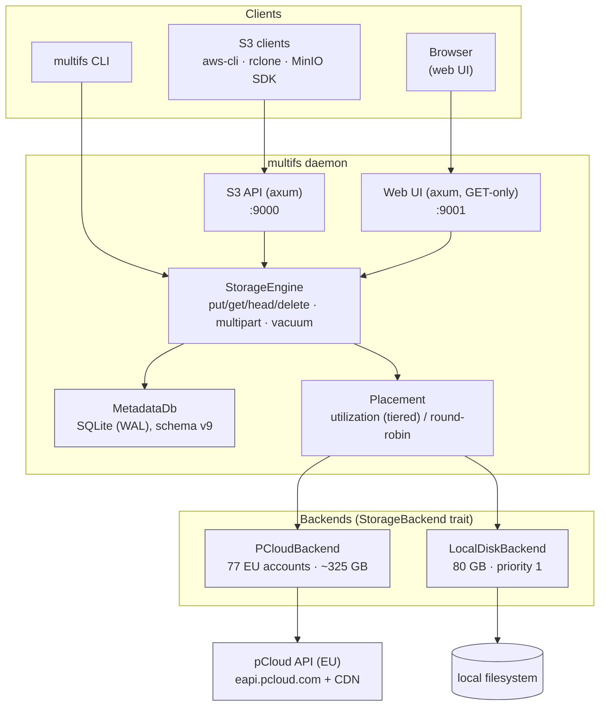

# MultiFS — Multi-Cloud Storage Pool

A MinIO/S3-compatible object storage service written in Rust that pools many
independent storage backends — currently **77 pCloud OAuth accounts (~325 GB)**
plus a **local disk (80 GB)** — behind a **single S3 endpoint** (port `9000`)
and an optional **read-only web UI** (port `9001`) and **metrics/health endpoint**
(port `9100`).

Objects are stored as **single self-contained blobs** with **copy-on-write MVCC
versioning**: an overwrite never mutates a blob in place — it writes a new
version and atomically flips the "current version" pointer.

> **New here? Pick your path:**
> - **Evaluating / planning** → [`docs/planning.md`](docs/planning.md)
> - **Running it (operator)** → [`docs/operator-guide.md`](docs/operator-guide.md)
> - **Using the S3 endpoint / web UI** → [`docs/user-guide.md`](docs/user-guide.md)
> - **Changing the code** → [`docs/developer-guide.md`](docs/developer-guide.md)

---

## Documentation map

| Audience | Page | Covers |
|----------|------|--------|
| **Planning / evaluation** | [`docs/planning.md`](docs/planning.md) | What it is, design goals, caveats & limitations, roadmap |
| **Operator** | [`docs/operator-guide.md`](docs/operator-guide.md) | Configuration, backends, deploy, observability, garbage collection |
| **User** | [`docs/user-guide.md`](docs/user-guide.md) | Concepts & terminology, S3 usage, web UI, folder metadata, symlinks |
| **User / operator** | [`docs/cli-reference.md`](docs/cli-reference.md) | Full CLI reference (every subcommand) |
| **Developer** | [`docs/developer-guide.md`](docs/developer-guide.md) | Repository layout, data-flow diagrams, running tests, adding a backend |
| **Developer** | [`docs/architecture.md`](docs/architecture.md) | Deep internals: data model, MVCC paths, GC, backend trait |
| — | [`docs/notes/`](docs/notes/) | Historical proposals / audits / design notes |
| — | [`config.example.toml`](config.example.toml) | Annotated, **generic** config template |

---

## Architecture at a glance



The `StorageEngine` is the single choke point: every protocol (S3, web UI, CLI)
talks to it, and it owns both the metadata DB and the list of backends. Adding
a protocol means adding an axum router; adding a storage target means
implementing the `StorageBackend` trait.


## Features

| Feature | Status |
|---------|--------|
| **S3-compatible API** — ListBuckets, Create/DeleteBucket, Put/Get/Head/Delete Object, ListObjectsV2 | ✅ |
| **S3 multipart upload** — Initiate / UploadPart / Complete / ListParts / Abort (rclone > 64 MB) | ✅ |
| **Multipart coalesce** — rewrite a completed multipart object into a single blob (`multifs object coalesce`, optional background) to drop per-part reads | ✅ |
| **S3 copy & versioning** — CopyObject, UploadPartCopy, ListMultipartUploads, ListObjectVersions (`versionId`), PutBucketVersioning | ✅ |
| **Single-blob MVCC versioning** — copy-on-write overwrite, old version kept for a grace period | ✅ |
| **HTTP Range streaming** — Range forwarded to the pCloud CDN (start/end) | ✅ |
| **Streaming PUT + request timeouts** — large binary PUTs stream body → pCloud with `Content-Length` (no whole-file buffering); per-request timeout prevents hangs | ✅ |
| **Tiered placement** — cloud-first, local disk as last resort (per-account `priority`) | ✅ |
| **`vacuum` garbage collection** — reclaims superseded + abandoned versions + abandoned multipart uploads | ✅ |
| **`import` command** — register existing pCloud file(s) (metadata only, single-file or `--scan`) | ✅ |
| **Content checksums** — SHA-256 stored per blob; `checksum rebuild\|verify` detects in-place drift | ✅ |
| **`fsck` health check** — DB integrity + backend presence/size + optional checksum verify (and `--prune-missing`) | ✅ |
| **Symlinks / tag folders** — present one folder under multiple paths without duplicating bytes | ✅ |
| **CLI management** — accounts, buckets, objects, backends, folder metadata, audit | ✅ |
| **Read-only web UI** — browser file navigator (GET-only: list buckets/objects, download) | ✅ |
| **Web UI column sorting** — click any column header to sort list/preview/names + buckets (persisted) | ✅ |
| **Web UI virtualization** — `content-visibility` skips off-screen cards; covers hydrate via `IntersectionObserver` (only visible thumbnails fetched) | ✅ |
| **Observability** — optional Prometheus `/metrics` (requests, bytes in/out, per-backend fill, GC reclaimed) + `/healthz` / `/readyz` health endpoints | ✅ |
| **Folder last-modified** — every folder shows the last add/remove/update in its subtree | ✅ |
| **S3 SigV4 authentication** — optional header-based signature verification (`server.access_keys`); unauthenticated by default | ✅ |
| WebDAV | ❌ Removed |
| NFS | ❌ Removed (was a stub; code deleted) |
| Erasure coding | ❌ Stub (single-blob model; each blob lives on one account) |


## Quick start

```bash
# Initialize config and database
multifs init

# Check connectivity to all backends
multifs check

# Start the daemon (S3 :9000, optional web UI :9001)
multifs serve
```


## License

MIT


## References

| Resource | URL |
|----------|-----|
| pCloud API documentation | https://docs.pcloud.com/ |
| pCloud OAuth 2.0 | https://docs.pcloud.com/methods/oauth_2.0/oauth2_token.html |
| S3 API reference | https://docs.aws.amazon.com/AmazonS3/latest/API/Welcome.html |
| HTTP Range (RFC 7233) | https://datatracker.ietf.org/doc/html/rfc7233 |
