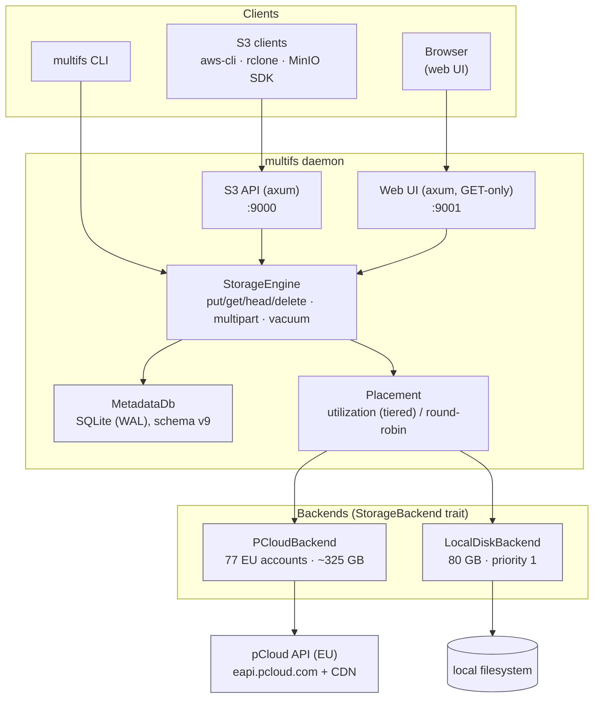
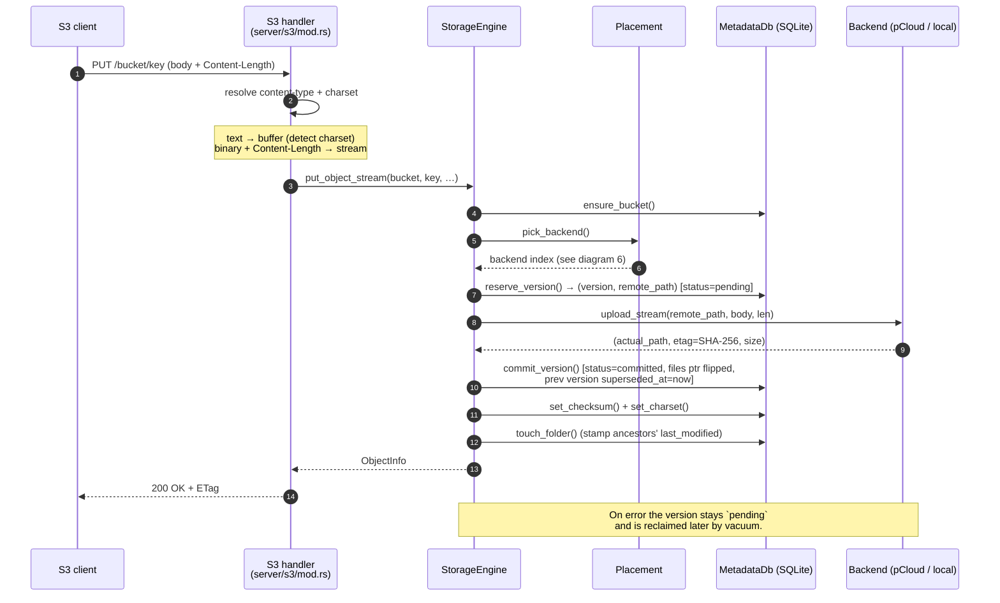
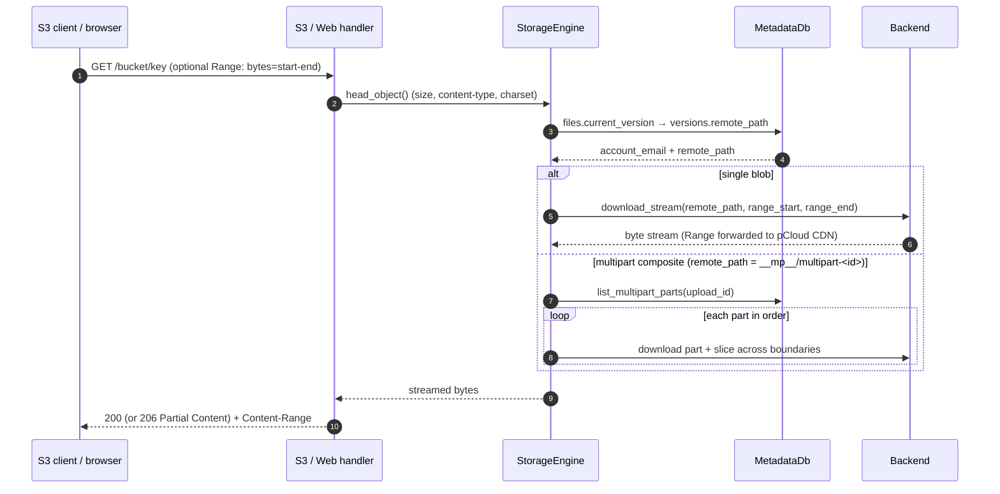
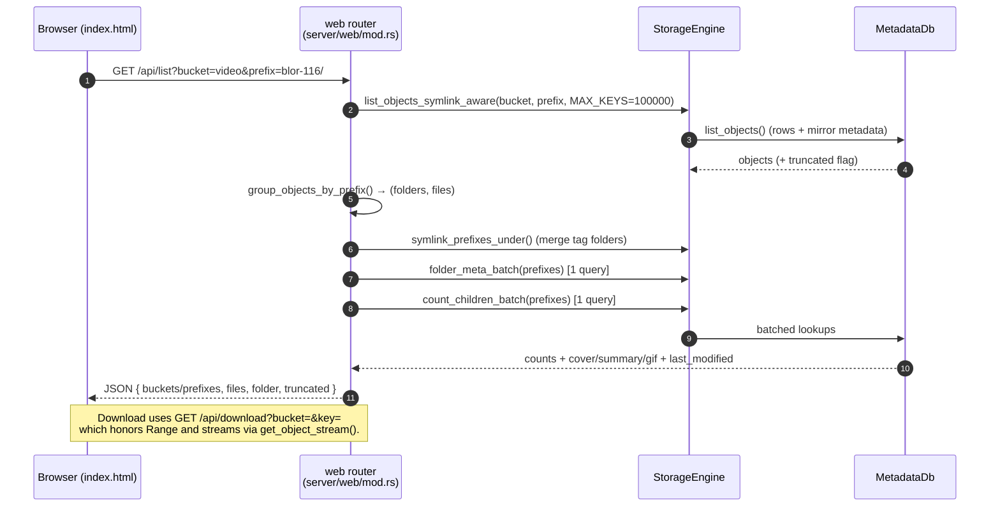
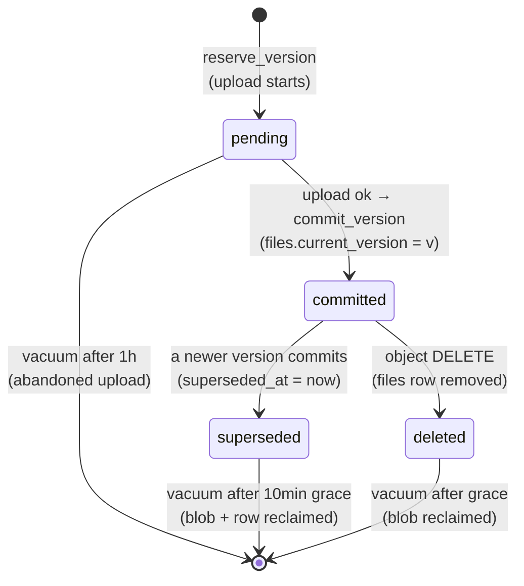

# MultiFS — Multi-Cloud Storage Pool

A MinIO/S3-compatible object storage service written in Rust that pools many
independent storage backends — currently **77 pCloud OAuth accounts (~325 GB)**
plus a **local disk (80 GB)** — behind a **single S3 endpoint** (port `9000`)
and an optional **read-only web UI** (port `9001`).

Objects are stored as **single self-contained blobs** with **copy-on-write MVCC
versioning**: an overwrite never mutates a blob in place — it writes a new
version and atomically flips the "current version" pointer.

> **Docs map**
> - [`docs/architecture.md`](docs/architecture.md) — deep reference (data model, read/write/delete paths, GC, placement, backend trait, known issues).
> - [`docs/notes/`](docs/notes/) — historical proposals / audits / design notes.
> - [`config.example.toml`](config.example.toml) — annotated, generic config template.

---

## Table of contents

- [Concepts & terminology](#concepts--terminology)
- [Architecture at a glance](#architecture-at-a-glance)
- [Data-flow diagrams](#data-flow-diagrams)
  - [1. Upload (`PutObject`)](#1-upload-putobject)
  - [2. Download (`GetObject`, with Range)](#2-download-getobject-with-range)
  - [3. Multipart upload](#3-multipart-upload)
  - [4. Web UI folder listing](#4-web-ui-folder-listing)
  - [5. Version lifecycle (MVCC + GC)](#5-version-lifecycle-mvcc--gc)
  - [6. Backend placement decision](#6-backend-placement-decision)
- [Features](#features)
- [Backends](#backends)
- [Repository layout](#repository-layout)
- [Quick start](#quick-start)
- [S3 usage](#s3-usage)
- [Configuration](#configuration)
- [CLI reference](#cli-reference)
- [Garbage collection](#garbage-collection)
- [Deploy](#deploy)
- [Running tests](#running-tests)
- [Caveats & limitations](#caveats--limitations)
- [Future improvements](#future-improvements)
- [License](#license)

---

## Concepts & terminology

| Term | Meaning |
|------|---------|
| **Bucket** | S3 namespace for objects. Registry table `buckets`. |
| **Key** | Object path inside a bucket (may contain `/`, e.g. `video/blor-116/cover.jpg`). |
| **Object** | A `(bucket, key)` pair plus its metadata; the thing S3 clients see. |
| **Blob** | The **physical** stored file on a backend. In the single-blob model, one object version = exactly one blob. |
| **Version** | An immutable snapshot of an object's content. MultiFS keeps history (MVCC). |
| **MVCC** | Multi-Version Concurrency Control — writers create new versions instead of overwriting; readers resolve the live version once at request start. |
| **Copy-on-write** | An overwrite writes a *new* blob and atomically repoints the live pointer; the old blob is left intact for readers/rollback until GC. |
| **`files` table** | Logical pointer: **one row per `(bucket, key)`** holding `current_version` and the mirrored size/etag/checksum. |
| **`versions` table** | One row per version — `account_email` + `remote_path` say *where the blob lives*. |
| **`pending`** | A reserved-but-not-yet-committed version (upload in flight). |
| **`committed`** | A version that completed; the live one is pointed at by `files.current_version`. |
| **Superseded / `superseded_at`** | A previously-live version after a newer one committed. Kept for a **grace period**, then GC-eligible. |
| **Backend** | A physical storage destination — a pCloud account or the local disk. |
| **Account** | Config entry describing a backend (`[[storage.accounts]]`): email, type, quota, `mount_prefix`, `priority`. |
| **`mount_prefix`** | Per-backend base path (e.g. `/multifs/01`) that blobs are stored under. |
| **Placement** | Choosing which backend receives a new upload. |
| **`priority`** | Lower = more preferred. Cloud backends default `0`; local disk `1`. |
| **Tier** | A group of backends at the same `priority`; tiers are filled in ascending order. |
| **`fill_ratio`** | `used / quota` for a backend; drives "least-full wins" within a tier. |
| **Shard** | Legacy CLI term for a backend in the pool — `multifs shard status` shows per-backend fill levels, `shard rebalance` moves data off over-full backends. The underlying concept is a *backend* (a pCloud account or local disk). |
| **ETag** | For a single-blob object, the **SHA-256 hex** of the blob (also stored as the checksum). For multipart objects, the S3 multipart ETag (MD5-of-part-MD5s `-N`). |
| **Checksum** | Stored SHA-256 of the live content; `checksum rebuild|verify` detects in-place drift. |
| **Charset** | Detected text encoding (BOM / UTF-8 validation) stored per version for correct serving. |
| **Multipart upload** | S3 large-file protocol: `Initiate → UploadPart* → Complete`. Parts are staged under a `__mp__/` prefix. |
| **Part** | One uploaded chunk of a multipart upload; each part is its own blob and may land on a different backend. |
| **Vacuum / GC** | Background reclaimer of blob bytes no live object references (see [GC](#garbage-collection)). |
| **Symlink (tag folder)** | A CLI-created alias: a folder prefix that re-presents another folder's contents under a second path (no bytes duplicated). |
| **Folder metadata** | Per-prefix `cover` / `summary` / `preview_gif` keys, shown on the web UI preview page. |
| **`last_modified` (folder)** | Epoch-ms stamp of the most recent add/remove/update anywhere in a folder's subtree. |
| **Schema version** | SQLite migration level (`meta.db`); currently **9**. |
| **`token_env`** | Name of the env var holding a backend's OAuth token — secrets never live in code/config. |

---

## Architecture at a glance



The `StorageEngine` is the single choke point: every protocol (S3, web UI, CLI)
talks to it, and it owns both the metadata DB and the list of backends. Adding
a protocol means adding an axum router; adding a storage target means
implementing the `StorageBackend` trait.

---

## Data-flow diagrams

### 1. Upload (`PutObject`)

A user uploads an object; the request streams through the S3 handler into the
engine, which reserves a version, streams the body to a chosen backend, then
commits.



### 2. Download (`GetObject`, with Range)

The read path resolves the live version once, so an in-flight download keeps
streaming even if a concurrent write flips the pointer.



### 3. Multipart upload

rclone (and any S3 client copying files > 64 MB) uses multipart. Each part is a
standalone blob and may land on a *different* backend; `Complete` keeps the
part rows so later reads can assemble the object.

```mermaid
sequenceDiagram
    autonumber
    participant C as S3 client
    participant H as S3 handler
    participant E as StorageEngine
    participant M as MetadataDb
    participant B as Backends

    C->>H: POST /b/key?uploads
    H->>M: create_multipart() → UploadId
    H-->>C: <UploadId>

    loop each part
        C->>H: PUT /b/key?partNumber=N&uploadId=X
        H->>E: upload_part()
        E->>M: reserve_version(staging)
        E->>B: upload_stream(__mp__/<id>/<N>)  [per-part backend pick]
        E->>M: store_multipart_part(account, path, md5)
        H-->>C: ETag (part MD5)
    end

    C->>H: POST /b/key?uploadId=X (part list)
    H->>E: complete_multipart_upload()
    E->>M: compute multipart ETag, commit version<br/>(remote_path = staging dir; parts retained)
    H-->>C: 200 + final ETag

    Note over C,M: DELETE ?uploadId=X (abort) deletes part blobs + rows.<br/>Abandoned uploads (>24h) are swept by vacuum.
```

### 4. Web UI folder listing

The read-only UI (GET-only) lists a folder's direct children. To keep a wide
folder fast, child counts and per-folder metadata are fetched in **two batched
queries** rather than one round-trip per child.



### 5. Version lifecycle (MVCC + GC)



### 6. Backend placement decision

```mermaid
flowchart TD
    START([put_object / upload_part]) --> STRAT{placement_strategy}
    STRAT -->|round-robin| RR["idx = counter++ % backends.len()"]
    STRAT -->|utilization (default)| Q["refresh_quotas() (cached)"]
    Q --> LVL["iterate priority tiers ascending<br/>(0 = preferred first)"]
    LVL --> BEST["pick least-full backend in tier<br/>(fill_ratio = used / quota)"]
    BEST --> FULL{fill_ratio < 1.0?}
    FULL -->|yes| PICK[use this backend]
    FULL -->|no| NEXTTIER{more tiers?}
    NEXTTIER -->|yes| LVL
    NEXTTIER -->|no| LEAST["all full → least-full overall (best effort)"]
    LEAST --> PICK
    RR --> PICK
    PICK --> END([reserve_version on chosen backend])
```

Net effect of the default (`utilization`) strategy: pCloud absorbs every write
while it has free space; the local disk (priority `1`) is a last-resort
overflow tier.

---

## Features

| Feature | Status |
|---------|--------|
| **S3-compatible API** — ListBuckets, Create/DeleteBucket, Put/Get/Head/Delete Object, ListObjectsV2 | ✅ |
| **S3 multipart upload** — Initiate / UploadPart / Complete / ListParts / Abort (rclone > 64 MB) | ✅ |
| **S3 copy & versioning** — CopyObject, UploadPartCopy, ListMultipartUploads, ListObjectVersions (`versionId`), PutBucketVersioning | ✅ |
| **Single-blob MVCC versioning** — copy-on-write overwrite, old version kept for a grace period | ✅ |
| **HTTP Range streaming** — Range forwarded to the pCloud CDN (start/end) | ✅ |
| **Streaming PUT + request timeouts** — large binary PUTs stream body → pCloud with `Content-Length` (no whole-file buffering); per-request timeout prevents hangs | ✅ |
| **Tiered placement** — cloud-first, local disk as last resort (per-account `priority`) | ✅ |
| **`vacuum` garbage collection** — reclaims superseded + abandoned versions + abandoned multipart uploads | ✅ |
| **`import` command** — register existing pCloud file(s) (metadata only, single-file or `--scan`) | ✅ |
| **Content checksums** — SHA-256 stored per blob; `checksum rebuild\|verify` detects in-place drift | ✅ |
| **`fsck` health check** — DB integrity + backend presence/size + optional checksum verify (and `--prune-missing`) | ✅ |
| **Symlinks / tag folders** — present one folder under multiple paths without duplicating bytes | ✅ |
| **CLI management** — accounts, buckets, objects, shards, folder metadata, audit | ✅ |
| **Read-only web UI** — browser file navigator (GET-only: list buckets/objects, download) | ✅ |
| **Web UI column sorting** — click any column header to sort list/preview/names + buckets (persisted) | ✅ |
| **Folder last-modified** — every folder shows the last add/remove/update in its subtree | ✅ |
| WebDAV | ❌ Removed |
| NFS | ❌ Removed (was a stub; code deleted) |
| Erasure coding | ❌ Stub (single-blob model; each blob lives on one account) |

---

## Backends

| Type | Notes |
|------|-------|
| pCloud (EU) | One backend per pCloud account — the reference deployment pools ~77 accounts (~325 GB combined). OAuth tokens via `token_env`. |
| Local disk | Single overflow backend (`priority = 1`). |

A backend is any type implementing the `StorageBackend` trait. Three ship in
tree: `PCloudBackend` (real), `LocalDiskBackend` (overflow tier), and
`MockBackend` / `TrackedBackend` (unit tests). See
[`docs/architecture.md`](docs/architecture.md#backend-interface-storagebackend-trait).

---

## Repository layout

```
src/
├── main.rs                 # clap CLI dispatch
├── config.rs               # Config model (server/storage/tls/accounts)
├── cli/                    # one module per subcommand (serve, account, bucket, …)
├── server/
│   ├── mod.rs              # shared helpers (range parse, prefix grouping, charset)
│   ├── s3/mod.rs           # S3 API router + handlers
│   └── web/                # read-only web UI router + embedded index.html
└── storage/
    ├── engine.rs           # StorageEngine — the single choke point
    ├── metadata.rs         # MetadataDb (SQLite, migrations, queries)
    ├── backends/           # StorageBackend trait + pcloud / local_disk impls
    └── pcloud/             # pCloud HTTP client + OAuth
tests/                      # integration tests (S3, WebDAV, pCloud, shell)
docs/
├── architecture.md         # deep reference
└── notes/                  # historical proposals / audits / designs
```

---

## Quick start

```bash
# Initialize config and database
multifs init

# Check connectivity to all backends
multifs check

# Start the daemon (S3 :9000, optional web UI :9001)
multifs serve
```

---

## S3 usage

```bash
aws configure set endpoint_url http://localhost:9000
aws configure set aws_access_key_id multifs
aws configure set aws_secret_access_key multifs

aws s3 mb s3://my-bucket
aws s3 cp file.txt s3://my-bucket/
aws s3 ls s3://my-bucket/
aws s3 cp s3://my-bucket/file.txt ./downloaded.txt
```

S3 multipart upload is fully implemented, so large-file copies (e.g.
`rclone copy` of files > 64 MB) work end-to-end. Any S3-compatible client works;
credentials are static (`multifs` / `multifs`) and are not enforced by the server.

---

## Configuration

Config lives at `/etc/multifs.toml` (or `/etc/multifs/config.toml`). See
[`config.example.toml`](config.example.toml) for an annotated, **generic**
template. Deployment-specific configs (real accounts, bind IPs, quotas) are kept
on the host only and are deliberately not committed to this repo.

```toml
[server]
bind = "0.0.0.0"
s3_port = 9000
enable_s3 = true
enable_nfs = false        # NFS support removed; field kept for config compatibility
enable_web = false        # read-only web UI (GET-only browser)
web_port = 9001

[storage]
meta_db_path = "/var/lib/multifs/meta.db"
placement_strategy = "Utilization"   # or "RoundRobin"

# pCloud account (cloud backends default to priority 0 = preferred)
[[storage.accounts]]
email = "nova-video-01@agentmail.to"
backend_type = "pcloud"
token_env = "PCLOUD_TOKEN_VIDEO_01"   # env var holding the OAuth token
mount_prefix = "/multifs/01"
quota_gb = 10

# Local disk backend (priority 1 = last resort; only absorbs overflow)
[[storage.accounts]]
email = "local-disk"
backend_type = "local"
mount_prefix = "/multifs/local"
path = "/var/lib/multifs/disk"
quota_gb = 80
priority = 1
```

### Placement

The config value is `"Utilization"` or `"RoundRobin"` (PascalCase, e.g.
`placement_strategy = "Utilization"`); the CLI/help form is lowercase
(`utilization` / `round-robin`).

- **`Utilization` (default, tiered)** — fill the lowest `priority` tier first,
  least-full backend within the tier wins; spill to the next tier only when the
  preferred tier is full. Local disk (`priority = 1`) only receives writes when
  every cloud account is out of free space.
- **`RoundRobin`** — cycles across all backends, ignoring priority.

### pCloud OAuth tokens

Tokens are read from environment variables at startup and referenced by
`token_env` name only — never stored in code or config. For the deployed host
they live in `/etc/multifs.env` (sourced by systemd) / `~/.openclaw/.env`.

- `PCLOUD_TOKEN_*` — one per account
- `PCLOUD_APP_CLIENT_ID` / `PCLOUD_APP_CLIENT_SECRET` — OAuth app credentials

> ⚠️ All pCloud accounts are registered in the **EU** region — every request must
> use `https://eapi.pcloud.com` (not `api.pcloud.com`).

To add a pCloud account:

1. Get an OAuth token: `multifs account add <email>` (or the manual OAuth flow).
2. Add an `[[storage.accounts]]` block to the config.
3. Restart: `sudo systemctl restart multifs.service`.

---

## CLI reference

```
multifs serve [--config <path>]   Start the daemon
multifs init [--config <path>] [--force]
                                  Initialize config + database
multifs check [--config <path>]   Validate config, test all accounts
multifs status                    Daemon health + account stats
multifs config show               Show current configuration
multifs config set <key> <value>  Set a config value (dot notation) — ⚠️ stub, not
                                  yet implemented (edit the config file directly)

multifs account list              List configured accounts
multifs account add <email> [--token <t>]
                                  Add an account (validates token, auto quota)
multifs account remove <email>    Remove an account from rotation
multifs account check <email>     Test token + show quota
multifs account refresh <email>   Refresh OAuth token

multifs bucket list               List buckets
multifs bucket create <name>      Create a bucket
multifs bucket delete <name> [--force]
                                  Delete a bucket (--force skips empty check)
multifs bucket info <name>        Bucket stats

multifs object list <bucket> [--prefix <p>] [--limit <n>]
                                  List objects
multifs object cp <src> <dst> [-r]
                                  Copy object (local ↔ remote)
multifs object rm <bucket>/<key>  Delete an object
multifs object info <bucket>/<key>
                                  Show object metadata

multifs shard status              Backend fill levels (objects + parts)
multifs shard rebalance [--dry-run]
                                  Move data over-full → under-full backends

multifs folder set-cover <bucket> <prefix> <key>
                                  Set a folder's cover image
multifs folder set-summary <bucket> <prefix> <key>
                                  Set a folder's summary document
multifs folder set-gif <bucket> <prefix> <key>
                                  Set a folder's preview GIF
multifs folder clear <bucket> <prefix>
                                  Clear all folder metadata
multifs folder backfill [--bucket <b>] [--dry-run]
                                  Scan objects and record cover/summary/GIF per folder
multifs folder list [--bucket <b>]  List recorded folder metadata

multifs link <bucket>/<key> <bucket>/<target>   Create a symlink (tag folder)
multifs link unlink <bucket>/<key>              Remove a symlink (target untouched)
multifs link list-links [--bucket <b>]          List symlinks

multifs audit scan <email> [--summary]          Find pCloud files NOT managed by MultiFS
multifs audit list-files <email>                List all files (managed + orphaned)
multifs audit reconcile [--account <email>]     Diff each account's files vs the DB
multifs audit cleanup [--account <email>] [--apply] [--verbose]
                                  Delete orphaned pCloud files (dry-run by default)

multifs import <email> <path> --bucket <b> [--key <k>]
                                  Register an existing pCloud file (metadata only)
multifs import <email> --scan [--bucket <b>] [--prefix <p>] [--dry-run]
                                  Bulk-import every unmanaged file in the account

multifs vacuum [--dry-run]        GC superseded + abandoned version blobs + abandoned multipart uploads

multifs checksum rebuild [path]   Recompute + store SHA-256 for one object
multifs checksum rebuild --all    Recompute + store SHA-256 for every object
multifs checksum verify [path]    Verify a stored checksum against live content
multifs checksum verify --all     Verify every object's checksum

multifs fsck [--checksums] [--fix] [--prune-missing] [--apply]
                                  Verify DB integrity + backend presence/size
                                  (--checksums also verify content; --fix repairs orphan
                                   multipart state + runs vacuum; --prune-missing [--apply]
                                   drops DB rows for blobs confirmed missing)
```

---

## Garbage collection

`multifs vacuum [--dry-run]` reclaims blobs no live file references (the server
also runs it automatically every 10 minutes):

1. **Abandoned uploads** — `pending` versions older than 1 hour (reserved but never committed).
2. **Superseded versions** — committed versions whose `superseded_at` is older than 10 minutes.
3. **Abandoned multipart uploads** — in-progress uploads initiated more than 24 hours ago:
   their staged part blobs, `multipart_uploads` and `multipart_parts` rows are all reclaimed.

Completed multipart objects keep their part rows for read assembly and are left
untouched. In-progress uploads can also be cancelled explicitly via S3
AbortMultipartUpload (`DELETE /bucket/key?uploadId=...`).

Multipart parts are reclaimed **per-account**: because each `UploadPart` picks a
backend independently, one upload's parts can live on 2–4 backends, and GC
deletes each part from the backend that actually holds it. A failed delete keeps
the metadata rows so a later vacuum retries instead of leaking bytes.

---

## Deploy

```bash
cargo build --release
sudo systemctl stop multifs.service
sudo cp target/release/multifs /usr/local/bin/multifs
sudo systemctl start multifs.service
```

Deployed as systemd `multifs.service`: binary `/usr/local/bin/multifs`, config
`/etc/multifs.toml`, env `/etc/multifs.env`, DB `/var/lib/multifs/meta.db`.
(Host-specific values live in the instance config, not this repo.)

---

## Running tests

```bash
cargo test --lib            # unit tests (132 passing) — count must match docs/architecture.md
cargo test                  # unit + integration tests
cargo test -- --nocapture   # with output
cargo clippy                # lints
```

---

## Caveats & limitations

Honest list of what MultiFS is **not** today — read before relying on it.

1. **No redundancy across accounts.** Each blob lives on exactly one pCloud
   account (single-blob model, no erasure coding / replication). If an account
   is suspended, rate-limited, or loses data, **those blobs are gone**. There is
   no automatic repair.
2. **Aggregating many free accounts is fragile.** The pool is built from ~77
   independently-registered pCloud accounts. Accounts can change quota
   (provisioning lag), get rate-limited, or be disabled; the effective capacity
   and availability therefore drift. `refresh_quotas` caches fill ratios, so
   placement can be briefly stale.
3. **No upload retry / backoff.** pCloud quota-full (`2008`), rate-limit (`429`),
   and auth failures (`2094`) fail the request immediately rather than retrying
   or falling back to another account. A transient backend error surfaces as a
   failed upload.
4. **Static, unenforced credentials.** The S3 endpoint accepts a fixed key/secret
   (`multifs`/`multifs`); the server does not authenticate or authorize callers.
   Do not expose port `9000` to untrusted networks — bind to a private/VPN
   interface (the deployed config binds a Tailscale IP).
5. **Multipart objects are read-assembled, not rewritten.** Completed multipart
   uploads keep their part blobs forever and are streamed back part-by-part, so a
   large object pays a per-part backend round-trip on read and every part row
   must stay in the DB.
6. **`import` is destructive to unmanaged sources.** An imported object's blob is
   indistinguishable from a MultiFS-owned one, so deleting the record (and later
   `vacuum`) deletes the *source* file on pCloud. Never delete records for files
   that matter elsewhere.
7. **Web UI is read-only by design, and off by default.** It exposes only GET
   routes; enable it (`server.enable_web = true`) only on a trusted interface.
8. **NFS and WebDAV are not available.** WebDAV was removed earlier; the NFS
   stub was deleted in the dead-code cleanup. `enable_nfs` / `nfs_port` remain in
   the config schema but do nothing.
9. **Single-node, single-process.** State lives in one SQLite DB (`meta.db`) and
   one process loop; there is no clustering, leader election, or replication.
   SQLite WAL serializes writers.
10. **No encryption at rest / no integrity on the wire to pCloud beyond TLS.**
    pCloud holds blobs as plain files; checksums detect *drift*, not tampering.
11. **Vacuum uses wall-clock grace windows.** A very long in-flight read that
    outlives the superseded grace period could, in principle, race GC; the 10-min
    window is sized well above normal request durations.
12. **Deployed config lives on the host, not in the repo.** Real account emails,
    bind addresses, and quotas are instance-specific and stay in `/etc/multifs.toml`
    (see [Deploy](#deploy)); `config.example.toml` is a generic template. Account
    count/quota quoted above reflect the current pool and drift as accounts are
    added.

---

## Future improvements

Roughly ordered by impact:

- **Redundancy / durability.** Erasure coding or N-way replication across
  accounts (the code already reserves the `.c1` blob slot and a chunk-index
  field), so a single account failure doesn't lose data. Add a repair/scrubber
  pass (`fsck --repair`) that reconstructs missing blobs.
- **Upload resilience.** Retry with exponential backoff on `429`/transient
  errors, and **automatic failover** to another account when a backend is
  quota-full or unauthorized.
- **Authentication & multi-tenancy.** Real S3 SigV4 auth, per-key access
  policies and quotas so the endpoint can be safely shared.
- **Multipart read optimization.** Optionally coalesce a completed multipart
  object into a single blob (background compaction) to remove per-part read
  round-trips and part-row retention.
- **Quota freshness.** Replace the cached fill-ratio snapshot with a lightweight
  TTL + periodic re-check, and expose quota drift in `status`.
- **Observability.** Structured metrics (`/metrics`: bytes in/out, per-backend
  fill, GC reclaimed, error rates) and health endpoints, instead of log-only
  tracing.
- **Web UI writes (opt-in).** Optional, authenticated upload/delete behind a flag,
  reusing the engine's write path — keeping GET-only as the safe default.
- **Object lifecycle rules.** Server-side expiry/transition policies so buckets
  can auto-tier or auto-expire instead of manual `vacuum`/`audit cleanup`.
- **Background integrity.** Scheduled `checksum verify --all` + self-healing to
  catch silent backend corruption early.
- **Remove remaining stubs.** Implement `config set`, and confirm no lingering
  WebDAV references remain.
- **CLI term cleanup.** Rename the `shard` subcommand to `backend` (or `disk`)
  for consistency with the rest of the docs; a breaking CLI change, so deferred.

---

## License

MIT

---

## References

| Resource | URL |
|----------|-----|
| pCloud API documentation | https://docs.pcloud.com/ |
| pCloud OAuth 2.0 | https://docs.pcloud.com/methods/oauth_2.0/oauth2_token.html |
| S3 API reference | https://docs.aws.amazon.com/AmazonS3/latest/API/Welcome.html |
| HTTP Range (RFC 7233) | https://datatracker.ietf.org/doc/html/rfc7233 |
