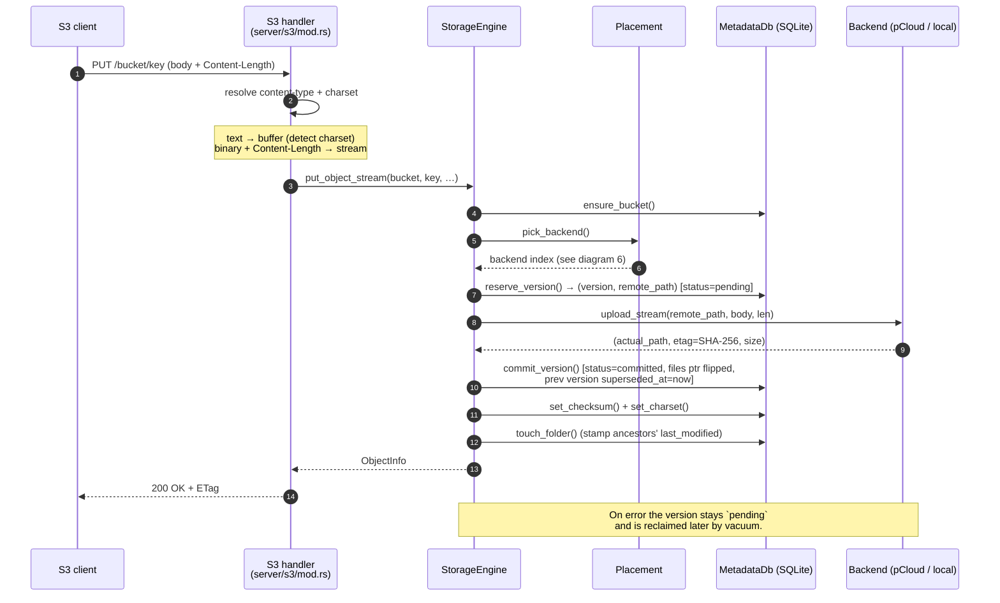
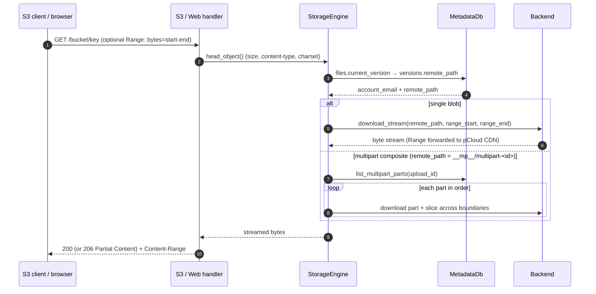
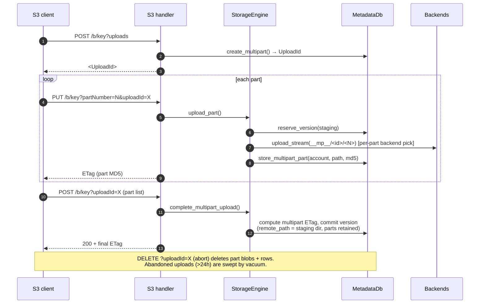
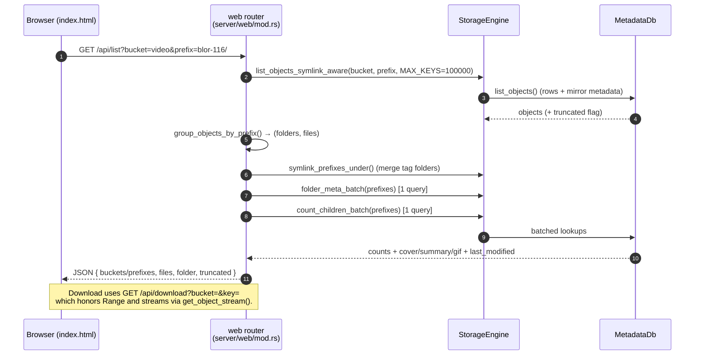
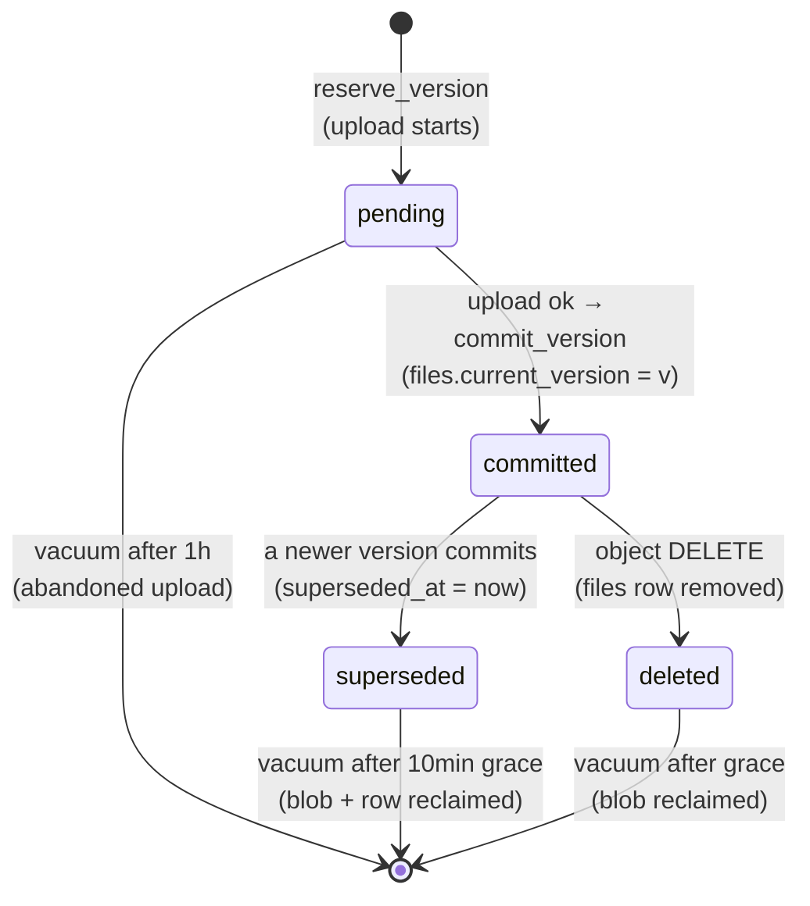
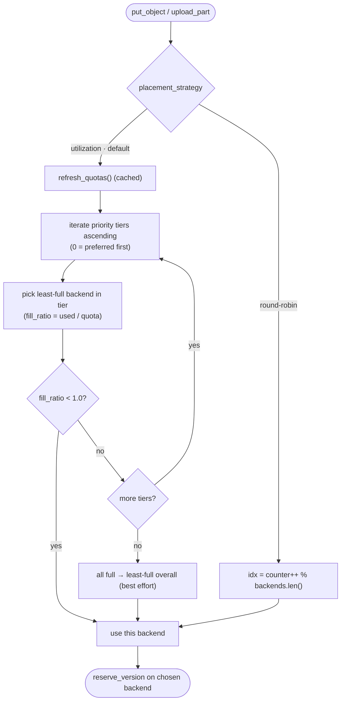

# MultiFS — Developer Guide

For changing the code: how it is laid out, how requests flow, and how to build/test it.
Deep internals (data model, MVCC paths, GC, backend trait) live in
[architecture.md](architecture.md). The component diagram is in the
[README](../README.md#architecture-at-a-glance).

## Data-flow diagrams

### 1. Upload (`PutObject`)

A user uploads an object; the request streams through the S3 handler into the
engine, which reserves a version, streams the body to a chosen backend, then
commits.



### 2. Download (`GetObject`, with Range)

The read path resolves the live version once, so an in-flight download keeps
streaming even if a concurrent write flips the pointer.



### 3. Multipart upload

rclone (and any S3 client copying files > 64 MB) uses multipart. Each part is a
standalone blob and may land on a *different* backend; `Complete` keeps the
part rows so later reads can assemble the object.



### 4. Web UI folder listing

The read-only UI (GET-only) lists a folder's direct children. To keep a wide
folder fast, child counts and per-folder metadata are fetched in **two batched
queries** rather than one round-trip per child.



### 5. Version lifecycle (MVCC + GC)



### 6. Backend placement decision



Net effect of the default (`utilization`) strategy: pCloud absorbs every write
while it has free space; the local disk (priority `1`) is a last-resort
overflow tier.


## Repository layout

```
src/
├── main.rs                 # clap CLI dispatch
├── config.rs               # Config model (server/storage/tls/accounts)
├── cli/                    # one module per subcommand (serve, account, bucket, …)
├── server/
│   ├── mod.rs              # shared helpers (range parse, prefix grouping, charset)
│   ├── s3/mod.rs           # S3 API router + handlers
│   └── web/                # read-only web UI router + embedded index.html
└── storage/
    ├── engine.rs           # StorageEngine — the single choke point
    ├── metadata.rs         # MetadataDb (SQLite, migrations, queries)
    ├── backends/           # StorageBackend trait + pcloud / local_disk impls
    └── pcloud/             # pCloud HTTP client + OAuth
tests/                      # integration tests (S3, WebDAV, pCloud, shell)
docs/
├── architecture.md         # deep reference
└── notes/                  # historical proposals / audits / designs
```


## Running tests

```bash
cargo test --lib            # unit tests (141 passing) — count must match docs/architecture.md
cargo test                  # unit + integration tests
cargo test -- --nocapture   # with output
cargo clippy                # lints
```


## Adding a storage backend

Implement the `StorageBackend` trait (`upload`, `upload_stream`, `download`,
`download_stream`, `list`, `stat`, `delete`, `server_side_copy`, …) in
`src/storage/backends/`, set its `backend_type` string, and wire it in
`StorageEngine::build_backends`. See
[architecture.md → Backend Interface](architecture.md#backend-interface-storagebackend-trait)
and [→ How a backend works](architecture.md#how-a-backend-works-protocol).
